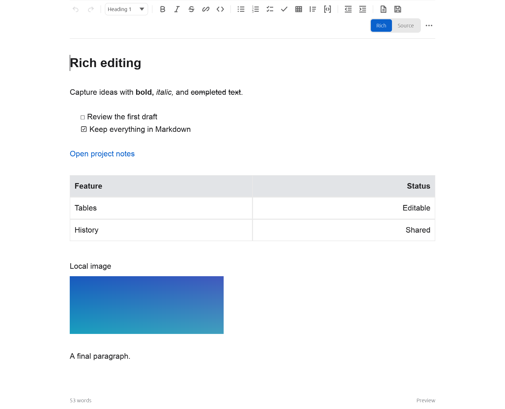
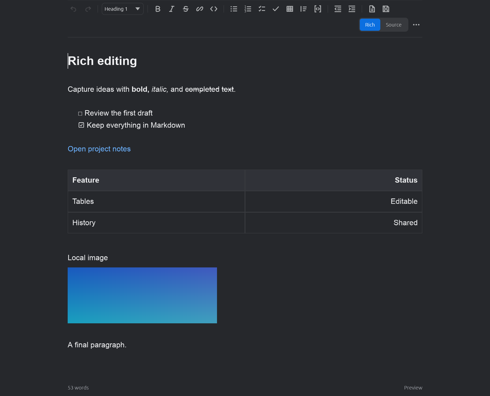

# glyphfolio-editor

**Rich Markdown editing. Native Rust. Ready to embed.**

Give your Rust application a writing surface with rich formatting, editable tables, and a configurable toolbar—all without a browser, WebView, JavaScript, or Node runtime.

Write visually in **Rich** mode or work directly with Markdown in **Source** mode. Both views edit the same document and share selection and undo history. Your text stays Markdown.

**v0.1.0 development preview · APIs may change.** [Preview status and compatibility](docs/PREVIEW_RELEASE.md)

| Light | Dark |
| --- | --- |
|  |  |

## A writing surface for your application

- **Rich text, Markdown underneath.** Headings, bold, italic, strikethrough, lists, tasks, blockquotes, links, wiki links, and code. Formatting markers stay folded as the caret moves through styled text.
- **Tables you can edit.** Native cells with wrapping and alignment, keyboard navigation, and controls to add or remove rows and columns.
- **One document, one history.** Switch between Rich and Source, edit, undo, and redo without converting between competing document models.
- **Your toolbar, your tools.** Choose commands, arrange toolbar groups, and adjust typography, spacing, content width, and themes through configuration.
- **Built for embedding.** Independent document, Markdown, and layout crates, with egui as the first UI adapter. Hosts control storage, assets, and application actions.
- **Bring content into your workflow.** HTML-to-Markdown paste conversion and host-provided image and attachment integration.

Built from scratch as an original editor, using low-level Rust storage, parsing, Unicode, shaping, and native UI libraries.

## Get started

Install **Rust 1.99.1 or newer** and your platform's native build tools, then open a terminal in this repository and run:

```sh
cargo run --locked -p glyphfolio-editor-demo
```

To try the sample document with tables, formatting, tasks, links, and an image:

```sh
cargo run --locked -p glyphfolio-editor-demo -- --source-file examples/standalone-egui/fixtures/editing-parity.md
```

Use the toolbar to format text or switch between **Rich** and **Source**. In a table, **Tab** moves between cells, **Enter** moves to the next row, and **Shift-Enter** adds a line break inside a cell. [More editing controls](docs/RICH_EDITING.md)

Build prerequisites: Xcode Command Line Tools on macOS; the MSVC Rust toolchain and Visual Studio C++ build tools on Windows; native windowing development packages on Linux. See [platform setup](docs/DEVELOPING.md#platform-setup) for details.

## Make it yours

Edit [editor.toml](editor.toml) to choose tools and appearance, or launch the demo with a supplied profile:

```sh
cargo run --locked -p glyphfolio-editor-demo -- --config config/minimal.toml
cargo run --locked -p glyphfolio-editor-demo -- --config config/full.toml
cargo run --locked -p glyphfolio-editor-demo -- --theme dark
```

Toolbar visibility and feature availability are separate: hide a button to simplify the surface, or disable its feature to turn off its supplied interactions. Existing document content stays intact.

[Configuration guide](docs/CONFIGURATION.md) · [Minimal profile](config/minimal.toml) · [Full profile](config/full.toml)

## Embed in an egui application

Keep the editor, view state, and configuration in your host. Inside your egui UI, show the configured surface:

```rust,ignore
EditorPanel::new(&mut editor, &mut view, &config).show(ui);
```

`EditorPanel` combines the toolbar and editing surface. Use `EditorWidget` and `EditorToolbar` separately when your application needs its own arrangement. Your host owns document metadata, persistence, and asset resolution.

Start with the [egui embedding guide](crates/editor-egui/README.md) and [host integration example](examples/host-integration/src/lib.rs).

| Crate | Responsibility |
| --- | --- |
| `glyphfolio-editor-core` | Documents, transactions, selection, editing commands, undo/redo |
| `glyphfolio-editor-markdown` | Parsing, source mapping, Rich projection, rich-edit planning |
| `glyphfolio-editor-layout` | Native shaping, wrapping, hit testing, table geometry, block virtualization |
| `glyphfolio-editor-egui` | Widget, toolbar, configuration, rendering, and native UI integration |

The core, Markdown, and layout crates are independent of egui and the GlyphFolio application.

## Explore and contribute

- [Editing guide](docs/RICH_EDITING.md)
- [Configuration](docs/CONFIGURATION.md)
- [Preview compatibility and known limitations](docs/PREVIEW_RELEASE.md)
- [Development setup and validation history](docs/DEVELOPING.md)
- [Roadmap](docs/REPLACEMENT_ROADMAP.md)
- [Changelog](CHANGELOG.md)
- [Contributing](CONTRIBUTING.md) · [Security](SECURITY.md)

## License

Original project code is available under your choice of [MIT](LICENSE-MIT) or [Apache-2.0](LICENSE-APACHE). See [third-party notices](THIRD_PARTY_NOTICES.md) for dependencies and separately licensed test fixtures.
